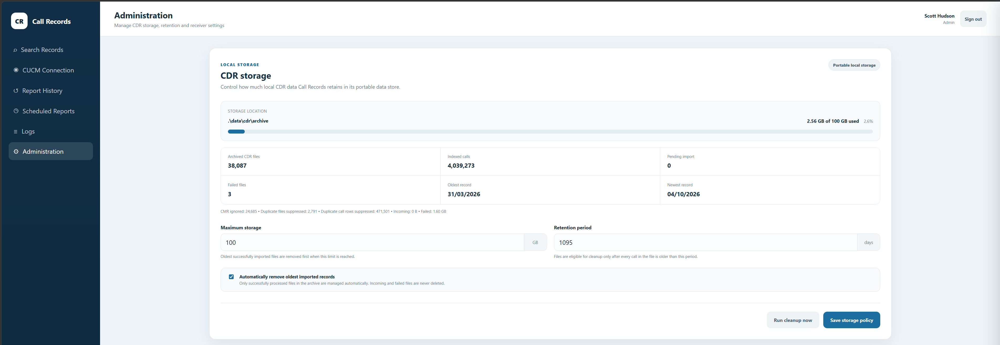
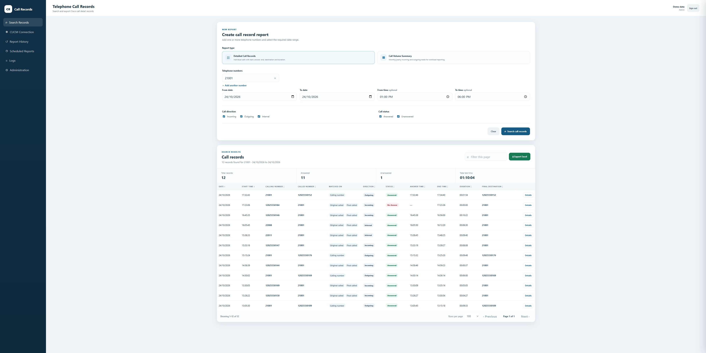
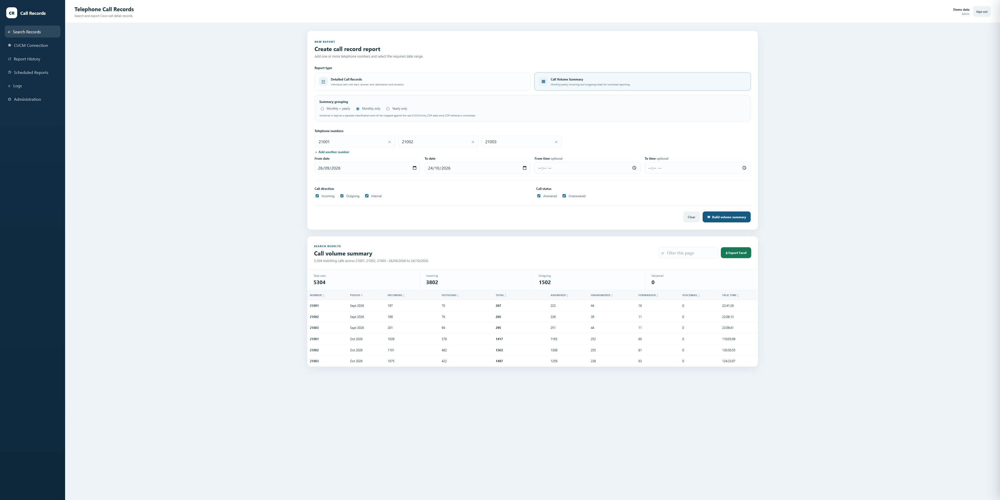
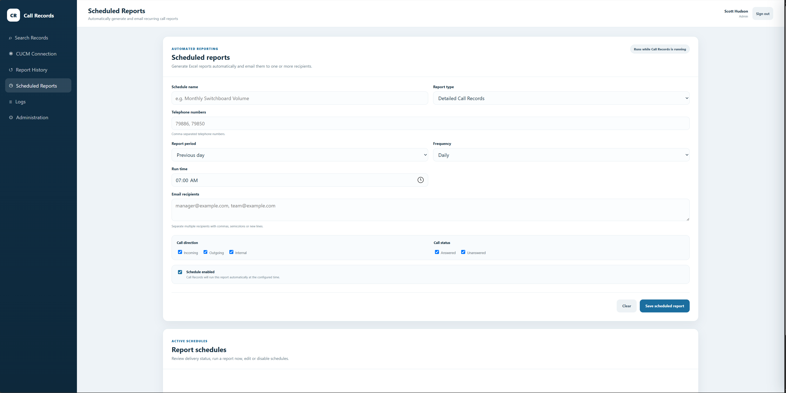
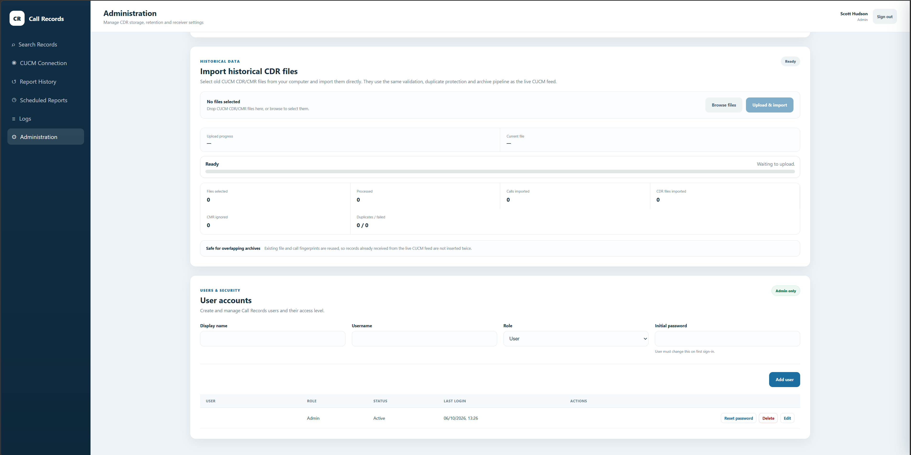
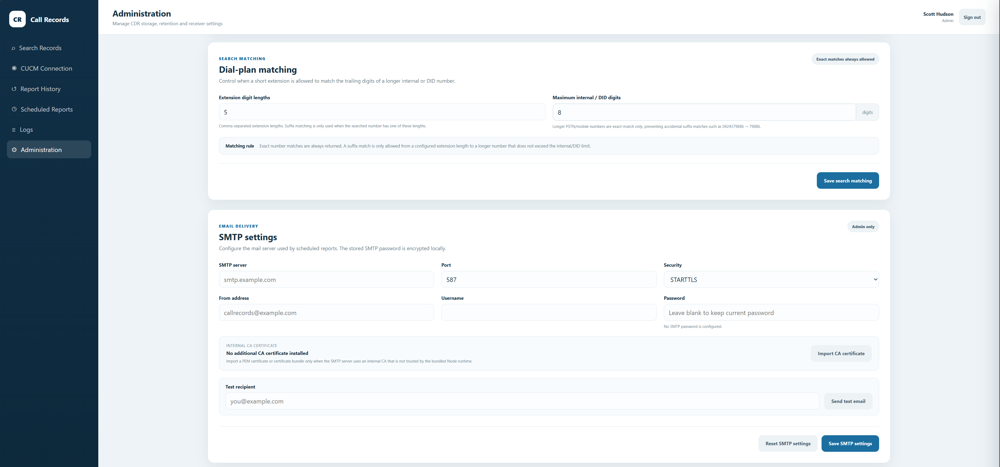
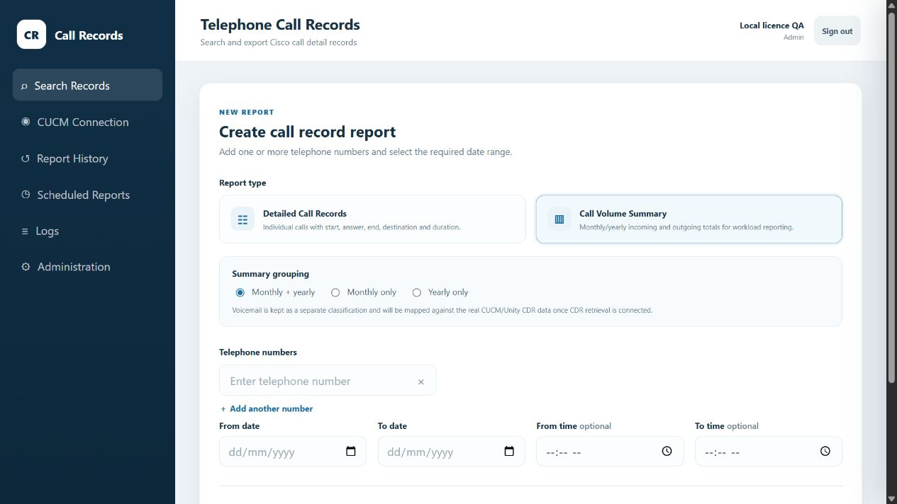

# CDR Search Tool

**Search, retrieve and report on Cisco CUCM call detail records from your own Windows installation.**

[Website](https://scotthudson.com.au/projects/call-records) · [Download for Windows](https://scotthudson.com.au/downloads/call-records) · [User guide](https://scotthudson.com.au/projects/call-records/docs) · [Full licence](https://scotthudson.com.au/purchase/call-records)

## Screenshots

The detailed search and call-volume examples use entirely fictional demonstration
data. Additional screenshots show the application's configuration and management
screens. Select an image to view it full size.

### Storage and retention

The storage view shows **4,039,273 indexed calls** and **38,087 archived CDR files**,
alongside disk usage, configurable storage limits and retention controls.

### Detailed call records

Search results with call direction, answer status, timings and final destination.

### Call-volume reporting

Monthly incoming and outgoing totals across three demonstration extensions,
including answered and unanswered calls, forwarding and talk time.

### Scheduled reports

Configure report type, telephone numbers, reporting period, frequency and email
recipients. Scheduled reports run while Call Records is running.

### Historical imports and user accounts

Import historical CUCM CDR files and manage application users and access levels.

### Dial-plan matching and email settings

Configure extension matching and the SMTP settings used for scheduled reports.

### Report setup

## Current release: v1.1.0

Released 24 October 2026. The download, purchase, licence delivery and activation
flow has been validated end to end by the developer.

- Search Cisco CUCM call records and export results.
- Receive CDR files through the embedded SFTP receiver.
- Import historical CDR files and retrieve records through CDR on Demand.
- Generate reports, review report history and configure scheduled reports.
- Manage user roles, audit history, SMTP, storage and retention.
- Run locally with the included runtime and production dependencies.

The experimental data-verification feature is **not included** in this release.
The application does not certify that source call records are complete.

## Free and Full editions

| | Free Edition | Full Licence |
| --- | --- | --- |
| Price | Free | A$100 once |
| Record retention | Up to 30 days | Longer configurable retention |
| Application features | Included | Included |
| Licence expiry | No time limit | No expiry |
| Future updates | Available through new releases | Included with your licence |

The Full Licence covers one organisation and one installation. Retained history
also depends on available disk space and the storage policy you configure.
The same installer supports both editions.

## Getting started

1. [Download the Windows ZIP](https://scotthudson.com.au/downloads/call-records), or choose the versioned Windows ZIP from [Releases](https://github.com/Huddo58/cdr-search-tool/releases/latest).
2. Extract the complete archive into its own folder. Keep all files together.
3. Run `START_CALL_RECORDS.cmd` and open `http://localhost:3080`.
4. Complete first-run administrator setup before connecting your team or CUCM.
5. Follow the [user guide](https://scotthudson.com.au/projects/call-records/docs) to configure ingestion, access and storage.

For a Full Licence, open **Administration → Licensing**, copy your **Instance ID**,
then [purchase your licence](https://scotthudson.com.au/purchase/call-records) using
that exact ID. Paste the emailed key into the same Licensing card and activate.
Activation does not change your chosen retention policy or run cleanup.

## Updates and backups

Keep the entire data folder backed up, including records, configuration,
installation identity and activated licence. Preserve it when updating. Install
new versions using the [update and rollback guidance](https://scotthudson.com.au/projects/call-records/docs/updates-and-rollback).
Existing Full licences include future Call Records updates for the licensed installation.

Version notes, the Windows package, the PDF guide and checksums are available on
each release. Verify the ZIP against the published SHA-256 before running it.

## Help and feedback

Start with the [documentation](https://scotthudson.com.au/projects/call-records/docs).
Use [Issues](https://github.com/Huddo58/cdr-search-tool/issues) for reproducible
bugs or feature requests. Include the version, expected behaviour and actual
behaviour. For purchase or licence help, [contact Scott](https://scotthudson.com.au/contact).

Issues are public. Do not post licence keys, credentials, customer call records,
phone numbers or private network details. Redact screenshots and logs.

## Support my projects

## About this repository

This is the public release, documentation and feedback repository. The application
source is maintained privately. Windows release packages contain the obfuscated
application and required runtime dependencies. GitHub's automatically generated
“Source code” archives contain this repository's documentation, not the application.
